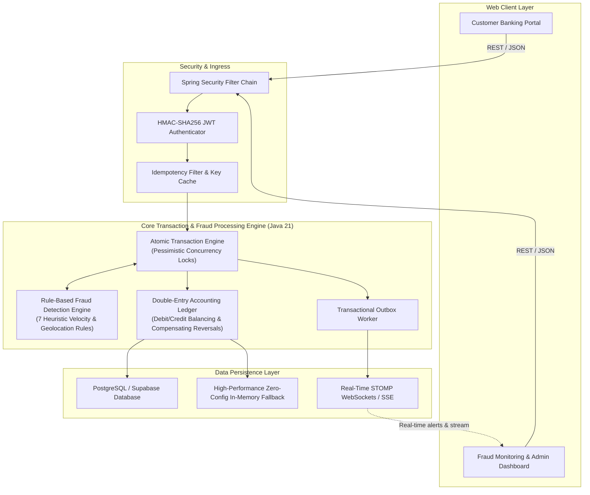

# SecureFlow — Distributed Banking Transaction & Fraud Detection Platform

> **Intelligent Banking. Secure Transactions. Real-Time Fraud Intelligence.**

SENTINEL is an enterprise-grade fintech banking transaction processing and real-time fraud detection engine built with **Java 21**, **Spring Boot 3**, **Spring Security**, and a modern **React 19 + TypeScript + Vite + Tailwind CSS** high-density financial dashboard.

---

## 1. System Architecture



---

## 2. Platform Portals

The application features two dedicated interfaces accessible via the top portal switcher:

### 1. Customer Banking Portal
- **Executive Overview**: Total liquid net worth, checking and savings sub-accounts, weekly inflow/outflow dynamics, and transaction activity.
- **Money Transfers**:
  - Source account selector with live balance.
  - Recipient account input with simulated validation.
  - Telemetry location simulator (New York, London, Tokyo, Singapore, Lagos, Zurich) to simulate travel velocity.
  - Review transfer screen with zero hidden fees.
  - Authorize & Execute with real-time risk screening.
  - Digital Transaction Receipt with cryptographic reference ID and verified double-entry balancing.
- **Transaction History**: Complete transaction ledger, real-time search, filters by status and type, and one-click **CSV Statement Export**.
- **Account Management**: Checking and savings details, daily spending limit meter, and active security sessions/telemetry.

### 2. Fraud Monitoring & Administration Dashboard
- **Fraud Overview & KPIs**:
  - 8 real-time fintech KPIs: Gross Volume, Total Transactions, Successful Transactions, Failed Transactions, Flagged Transactions, Blocked Transactions, Fraud Detection Rate %, and High-Risk Entities.
  - Interactive Recharts analytics: 24h Transaction Stream Dynamics (Normal vs Flagged vs Blocked), Risk Tier Breakdown Donut (0-100), Settled Volume by Category, and Active Fraud Alert Triage.
- **Live Transaction Monitoring**: High-density real-time audit stream displaying every transaction across the system with risk badges, telemetry location, inspection drawer, and administrative **Compensating Reversal** action.
- **Fraud Alert Center**: Triage queue for fraud analysts with severity badges, rule breakdown, and status actions (*Investigate*, *Confirm Fraud*, *False Positive*, *Resolve*).
- **Case Dossier & Investigation Modal**: Complete transaction information, risk score breakdown, triggered rules breakdown with point weights, telemetry comparison, and analyst notes timeline.
- **Fraud Rules Administration**: Live configuration of threshold values, risk score weights, time windows, and active states for all 7 rules.
- **Threat Vector Simulator**: 1-click execution of simulated fraud vectors (High-Value Spike, Rapid Burst, Impossible Travel Velocity, Structuring) with immediate live feedback.

---

## 3. Fraud Detection Engine (7 Active Rules)

SENTINEL implements a deterministic, rule-based scoring engine where each rule contributes weighted points capped at 100:

| Rule Code | Rule Name | Description | Default Weight | Action |
| :--- | :--- | :--- | :--- | :--- |
| `RULE_LARGE_AMOUNT` | Unusually Large Transaction | Flags transfers exceeding single-transaction threshold ($10,000) | **+25 pts** | `FLAG` |
| `RULE_RAPID_TXN` | Rapid Multiple Transactions | Detects high-velocity bursts (3+ transfers within 120s) | **+20 pts** | `FLAG` |
| `RULE_UNUSUAL_FREQ` | Unusual Transaction Frequency | Flags accounts exceeding typical hourly density (5+ in 1 hour) | **+15 pts** | `FLAG` |
| `RULE_INSUFFICIENT_BALANCE` | Insufficient Balance Shortfall | Immediately rejects transfers exceeding available liquidity | **+30 pts** | `BLOCK` |
| `RULE_GEO_VELOCITY` | Suspicious Geolocation Velocity | Uses **Haversine formula** to detect impossible travel speeds (> 800 km/h) | **+25 pts** | `FLAG` |
| `RULE_REPEAT_FAIL` | Repeated Failed Attempts | Detects repeated failed transactions (3+ failures in 300s) | **+15 pts** | `HOLD` |
| `RULE_STRUCTURING` | Structuring / Smurfing Pattern | Flags multiple transactions ($8,500–$9,999) designed just below $10,000 reporting threshold | **+20 pts** | `FLAG` |

### Risk Decision Matrix:
- **0–29 (LOW)**: Automatically approved and settled.
- **30–59 (MEDIUM)**: Approved and flagged for behavioral monitoring.
- **60–79 (HIGH)**: Transaction held in `FLAGGED` state for compliance analyst triage.
- **80–100 (CRITICAL)**: Transaction immediately `BLOCKED` and funds protected.

---

## 4. Transaction Processing & Accounting Integrity

1. **Atomic Transactions**: Transfers execute within a single `@Transactional(rollbackFor = Exception.class)` boundary. Debits and credits succeed together or roll back entirely.
2. **Idempotency Protection**: Every transfer request accepts an `Idempotency-Key`. Cached responses prevent duplicate transfers in network retries.
3. **Deadlock-Free Concurrency Control**: Accounts are locked using `LockModeType.PESSIMISTIC_WRITE` in sorted UUID order, completely eliminating deadlock conditions.
4. **Double-Entry Ledger**: Every transfer creates balanced `LedgerEntry` records (`sum(DEBIT) == sum(CREDIT)`).
5. **Compensating Reversals**: Completed transactions are never deleted. Reversals issue compensating debit/credit entries, updating transaction state to `REVERSED`.

---

## 5. Quick Start Guide

### Prerequisites
- Java 21+
- Node.js 18+ and npm
- (Optional) Docker for containerized deployment

### Option A: Local Development (Instant Out-of-the-Box)

1. **Launch Backend (Spring Boot 3.3.5, Java 21)**:
   ```cmd
   start-backend.bat
   ```
   *Backend runs on `http://localhost:8080` (H2 Console at `/h2-console`, Swagger Docs at `/swagger-ui.html`).*

2. **Launch Frontend (Vite + React 19 + Tailwind CSS)**:
   ```cmd
   start-frontend.bat
   ```
   *Dashboard runs on `http://localhost:5173`.*

3. **Or Launch Both with One Command**:
   ```cmd
   run-all.bat
   ```

### Option B: Full Distributed Docker Deployment

```bash
docker-compose up --build
```
This spins up:
- PostgreSQL 16 on port `5432`
- Redis 7 on port `6379`
- Apache Zookeeper on port `2181` & Apache Kafka on port `9092`
- Spring Boot Backend on port `8080`
- React Frontend on port `5173`

---

## 6. Demo Persona Credentials

| Persona | Username | Password | Role | Description |
| :--- | :--- | :--- | :--- | :--- |
| **Alexander Vance** | `customer` | `SentinelCustomer123!` | `CUSTOMER` | Primary customer checking ($48,250.75) & savings ($125,000) |
| **Fraud Analyst** | `analyst` | `SentinelAnalyst123!` | `FRAUD_ANALYST` | Triage alerts, add case notes, resolve investigations |
| **Chief Risk Officer** | `admin` | `SentinelAdmin123!` | `ADMIN` | System-wide admin, rule policies, compensating reversals |

*Tip: You can switch between roles in 1 click using the Role buttons in the top navbar!*

---

## 7. Connecting to Supabase PostgreSQL

To connect SENTINEL to a cloud Supabase database:
1. In your **Supabase Dashboard**, navigate to **Project Settings &rarr; Database**.
2. Copy the connection string under **Connection string &rarr; URI**.
3. Set the following environment variables (or update `.env` / `application.yml`):
   ```properties
   SPRING_DATASOURCE_URL=jdbc:postgresql://db.<your-supabase-ref>.supabase.co:5432/postgres
   SPRING_DATASOURCE_USERNAME=postgres
   SPRING_DATASOURCE_PASSWORD=<your-supabase-db-password>
   SPRING_DATASOURCE_DRIVER=org.postgresql.Driver
   ```
4. Run Flyway migration or allow Hibernate `ddl-auto: update` to automatically sync schema tables.

---

## 8. Verification & Automated Test Suite

Run the complete automated test suite verifying fraud detection rules, atomic transactions, idempotency, ledger balancing, and reversals:

```cmd
cd backend
mvn test
```

Test Results:
- `FraudDetectionEngineTest`:
  - `RULE 1`: Large transaction threshold breach (+25 pts) &rarr; **PASSED**
  - `RULE 4`: Insufficient balance rejection &rarr; **PASSED**
  - `RULE 5`: Haversine impossible travel velocity &rarr; **PASSED**
  - Haversine distance accuracy verification (~5,570 km) &rarr; **PASSED**
  - Risk score capping at 100 &rarr; **PASSED**
- `TransactionProcessingIntegrationTest`:
  - Atomic transfer with double-entry ledger invariant &rarr; **PASSED**
  - Idempotency key duplicate protection &rarr; **PASSED**
  - Insufficient balance rejection and rollback &rarr; **PASSED**
  - Administrative reversal with compensating ledger entries &rarr; **PASSED**

---

## 9. API Reference

- `POST /api/auth/register` — Register customer account
- `POST /api/auth/login` — Authenticate and receive JWT Bearer token
- `GET /api/accounts` — List current user accounts
- `GET /api/accounts/{id}/balance` — Live balance query
- `POST /api/transactions/transfer` — Execute transfer with fraud screening
- `GET /api/transactions` — Transaction ledger history
- `POST /api/transactions/{id}/reverse` — Reverse transaction with compensating entries
- `GET /api/transactions/export/csv` — Download CSV financial statement
- `GET /api/fraud/alerts` — Fraud triage queue
- `POST /api/fraud/alerts/{id}/resolve` — Adjudicate alert status
- `GET /api/admin/dashboard` — Comprehensive analytics overview
- `GET /api/admin/fraud-rules` — List active rule configurations
- `PUT /api/admin/fraud-rules/{id}` — Configure rule threshold and weight
- `POST /api/demo/trigger/{scenario}` — Trigger simulated fraud scenario
